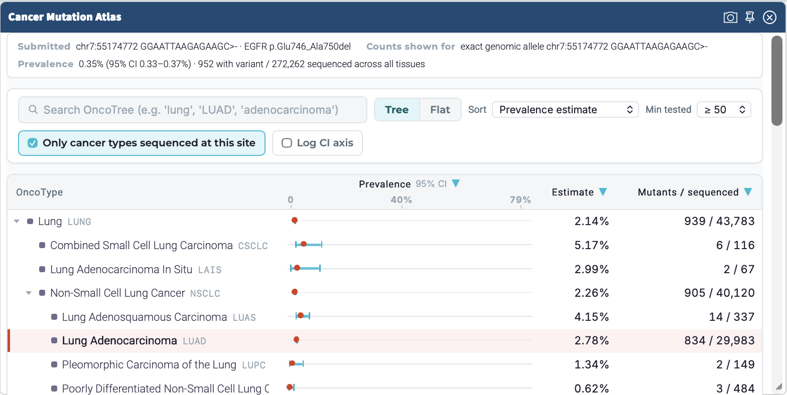

# Cancer Mutation Atlas

The Cancer Mutation Atlas aggregates somatic mutation counts and position-specific coverage denominators by OncoTree cancer types, across many studies. It provides the broadest estimates of SNV and indels prevalence available as an open dataset. 



## Variant matching

Input variants are matched to somatic mutations in the CMA in three ways:

- `Exact Match` - corresponds to exactly the same chromosome position, reference sequence, and alternate
- `Protein Change` - though not an exact nucleotide match, the input variant results in the same protein change in at least one of the transcripts of a gene
- `Genomic Location` - the input variant overlaps a CMA variant, but with different nucleotide change and no matching protein changes.

Matching prefers the same biological allele (including repeat-shifted indels), then the primary mapper's gene/protein change among nearby alleles, then overlapping genomic location. Protein matching uses only OpenCRAVAT's selected primary transcript; it does not search the entire gene or alternate-transcript consequences.

Additional ields `variant_count` and `variant_count_tissue` report the number of samples in CMA that matched the input variant. The integer `variant_count` field is a sum of all samples that contained the variant.  Per-OncoTree counts are in the variant_count_tissue as a JSON table that has the OncoTree code, the number of samples containing the matched variant, and number of samples in the CMA that have sequencing coverage at the site. Zero-numerator OnceTree nodes are omitted from this table. The hidden `direct_counts` field supplies the CMA WebViewer widget with every
direct OncoTree count, including covered nodes with no carriers.

For a protein-change match, the numerator sums variant counts from every matched
CMA allele that results in the same protein change (or synonymous protein sequence). 
The sequenced-patient denominator is calculated once from assay
coverage at the submitted genomic locus; it is not summed or maximized across
the matched alleles' loci. Counts and coverage are first calculated separately
by OncoTree code, then summed when reporting a total across tissues.

## Querying Specific OncoTree Depths and Nodes

When running on the command line, module options can customize the reporting. The default query is `depth=1`: all tissue nodes (`BREAST`, `BOWEL`, `BONE`,
and so on) are returned separately. The root depth of `TISSUE` is `0`.
To retrieve the raw counts at each node, without adding up the sum children nodes, 
use `depth=-1`. Named descendant rollups and exact nodes can be combined:

```text
--module-option cma.depth=1
--module-option cma.direct=BRCANOS,IDC
```

Set `depth=none` and `nodes=BREAST,BOWEL` to request only named descendant
rollups. `direct` excludes sample counts from descendants of the requested node.

On the gene tab, the module also reports mutation-positive cases and integer
counts of cases tested for each gene, both in total and by direct OncoTree
cancer type. These come from the database's precomputed `gene` table, not from
the submitted variants. A cancer type's tested count is the maximum case count
at any mapped atlas locus in the gene, so hotspot-only panels count as covering
the gene.

## Studies and references

- AACR Project GENIE Consortium. [AACR Project GENIE: Powering Precision Medicine through an International Consortium.](https://pubmed.ncbi.nlm.nih.gov/28572459/) Cancer Discov. 2017;7(8):818–831.
- Ellrott K, Bailey MH, Saksena G, et al. (MC3 Working Group; Cancer Genome Atlas Research Network). [Scalable Open Science Approach for Mutation Calling of Tumor Exomes Using Multiple Genomic Pipelines.](https://pubmed.ncbi.nlm.nih.gov/29596782/) Cell Syst. 2018;6(3):271–281.e7.
- Hartmaier RJ, Albacker LA, Chmielecki J, et al. [High-Throughput Genomic Profiling of Adult Solid Tumors Reveals Novel Insights into Cancer Pathogenesis.](https://pubmed.ncbi.nlm.nih.gov/28235761/) Cancer Res. 2017;77(9):2464–2475.
- Li Y, Dou Y, Da Veiga Leprevost F, et al. (Clinical Proteomic Tumor Analysis Consortium). [Proteogenomic data and resources for pan-cancer analysis.](https://pubmed.ncbi.nlm.nih.gov/37582339/) Cancer Cell. 2023;41(8):1397–1406.
- Wu L, Yao H, Chen H, et al. [Landscape of somatic alterations in large-scale solid tumors from an Asian population.](https://pubmed.ncbi.nlm.nih.gov/35871175/) Nat Commun. 2022;13:4264.
- Morton LM, Karyadi DM, Stewart C, et al. [Radiation-related genomic profile of papillary thyroid carcinoma after the Chernobyl accident.](https://pubmed.ncbi.nlm.nih.gov/33888599/) Science. 2021;372(6543):eabg2538.
- Govindan R, Mandrekar SJ, Gerber DE, et al. [ALCHEMIST Trials: A Golden Opportunity to Transform Outcomes in Early-Stage Non-Small Cell Lung Cancer.](https://pubmed.ncbi.nlm.nih.gov/26672084/) Clin Cancer Res. 2015;21(24):5439–5444. (Trial design paper; ALCHEMIST has no separate GDC dataset publication.)
- Armenia J, Wankowicz SAM, Liu D, et al. [The long tail of oncogenic drivers in prostate cancer.](https://pubmed.ncbi.nlm.nih.gov/29610475/) Nat Genet. 2018;50(5):645–651.
- Pereira B, Chin SF, Rueda OM, et al. [The somatic mutation profiles of 2,433 breast cancers refines their genomic and transcriptomic landscapes.](https://pubmed.ncbi.nlm.nih.gov/27161491/) Nat Commun. 2016;7:11479.
- Bernard E, Tuechler H, Greenberg PL, et al. [Molecular International Prognostic Scoring System for Myelodysplastic Syndromes.](https://pubmed.ncbi.nlm.nih.gov/38319256/) NEJM Evid. 2022;1(7):EVIDoa2200008.
- Knisbacher BA, Lin Z, Hahn CK, et al. [Molecular map of chronic lymphocytic leukemia and its impact on outcome.](https://pubmed.ncbi.nlm.nih.gov/35927489/) Nat Genet. 2022;54(11):1664–1674.
- Reddy A, Zhang J, Davis NS, et al. [Genetic and Functional Drivers of Diffuse Large B Cell Lymphoma.](https://pubmed.ncbi.nlm.nih.gov/28985567/) Cell. 2017;171(2):481–494.e15.